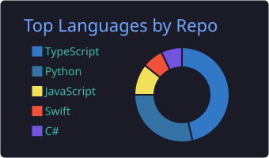

<h1 align="center">Akshay Kalapgar</h1>

  <strong>AI / agent engineer in San Francisco.</strong> 
  I build LLM agents that ship to real users, and the evals, guardrails and tooling that keep them reliable.

  
  
  
  
  

## What I do

- **Ship agents to production.** I took Goldi, an AI career agent, from prototype to **100K+ users** through a Walmart partnership.
- **Build the reliability layer around them.** Eval harnesses with blinded LLM judges, guardrails, scoped tools, human-review gates and tracing on every agent run.
- **Build tooling other engineers use.** An MCP tool harness and a Claude Code plugin system of **86 skills**, used daily by 20 engineers.
- **Own the whole stack.** TypeScript and Python services, React and Next.js frontends, PostgreSQL, AWS, Kubernetes and Terraform.

## Experience

| | |
|---|---|
| **[Climb Together](https://www.climbtogether.co)**   Full Stack Developer & AI Engineer   2025 to present | Goldi, a production AI career agent (TypeScript, Next.js, Claude, OpenAI): **100K+ users** via Walmart, 30K monthly active users, 10,000+ sessions a day. Real-time voice pipeline (Deepgram streaming STT, Claude, Cartesia TTS, turn-taking and barge-in). Idempotent event-driven integrations (Twilio SMS/WhatsApp, TalentLMS). **+28% re-engagement** from fixes found in product data. |
| **[Softmax](https://softmax.com)**   AI Platform Engineer (contract)   2025 to 2026 | MCP tool harness and Claude Code plugin system (**86 skills, 6 plugins**) used daily by 20 engineers, with input validation, scoped tools and human review. Kubernetes job watcher, Datadog and OpenTelemetry tracing, Terraform on AWS, 21-table PostgreSQL schema. **1,180+ commits** to open-source [Metta AI](https://github.com/Metta-AI). |
| **[UMass Chan Medical School](https://www.umassmed.edu)**   Software Engineer Intern   2024 to 2025 | Led [Factorbook 2.0](https://github.com/weng-lab/Factorbook2.0) (React, Next.js, GraphQL): **40% faster** first contentful paint, **55% lower** API latency, backend moved to AWS Lambda, 500+ tests. |
| **Capgemini**   Full Stack Engineer   2021 to 2023 | 10+ Java/Spring Boot microservices for BMW's global platform (**200K+ users, 99.9% uptime**). Mentored 4 engineers. |
| **tag8**   Software Engineer   2020 to 2021 | Shopify store integration (Admin API, order and inventory webhooks) for a store that sold **$1M+** in products. Redis caching over Elasticsearch: 60% lower query latency. |

## Open source

Projects I built to go deep on a problem. Each README says what the project does and what it leaves out.

| Project | What it is | Stack |
|---|---|---|
| [agent-harness-lab](https://github.com/Akkikens/agent-harness-lab) | Agent harness with capability-gated sandboxed tools, durable journaled runs that resume after a crash, and a record/replay eval gate | Python |
| [mcp-policy-gateway](https://github.com/Akkikens/mcp-policy-gateway) | Identity-aware MCP gateway: OAuth 2.1 resource server, SCIM 2.0, signed Cedar policy bundles with rollback protection, hash-chained audit log | Go |
| [secure-agent-service](https://github.com/Akkikens/secure-agent-service) | Support agent on Microsoft Agent Framework: identity propagation, least-privilege tools, approval gates, ACL-filtered RAG with citations | C#, Azure Functions |
| [workspace-agent](https://github.com/Akkikens/workspace-agent) | Workplace agent with Jira, Confluence and Microsoft Graph tools, approval-gated writes, governed NL-to-SQL and a VS Code extension | C#/.NET, Angular, TypeScript |
| [dbt-orchestrator-lab](https://github.com/Akkikens/dbt-orchestrator-lab) | dbt job control plane: scheduler, leased workers with fencing tokens, Kafka outbox and an idempotent results projection | Rust, Postgres, Kafka |
| [shopify-commerce-lab](https://github.com/Akkikens/shopify-commerce-lab) | Shopify app with a discount Function, Markets price-list sync, a Hydrogen storefront and a webhook pipeline on SQS, Lambda and EventBridge | TypeScript, AWS CDK |
| [localfirst-notes](https://github.com/Akkikens/localfirst-notes) | Collaborative rich-text editor that syncs over WebSockets and merges offline edits | TypeScript, TipTap, Yjs |
| [prtray](https://github.com/Akkikens/prtray) | GitHub pull request tray for the Mac menu bar | Swift, SwiftUI |
| [ai-agent-lab](https://pypi.org/project/ai-agent-lab/) | Toolkit on PyPI for building agent systems with Claude Code: MCP servers, orchestration, skills and hooks | Python |

## Stack

**Languages:** TypeScript, Python, Java, Go, C#, Rust, Swift 
**AI:** Claude, OpenAI, MCP, Claude Code, Vercel AI SDK, LangChain, RAG, agent evals and guardrails, real-time voice (Deepgram, Cartesia, ElevenLabs) 
**Backend and data:** Node.js, FastAPI, Spring Boot, GraphQL, PostgreSQL, Redis, Elasticsearch, Kafka 
**Frontend:** React, Next.js 
**Cloud and delivery:** AWS (Lambda, SQS, EventBridge, S3, EKS), Kubernetes, Terraform, Docker, GitHub Actions 
**Observability and testing:** Datadog, OpenTelemetry, Sentry, PostHog, Jest, Playwright

## Publications

- *DGA Based Malware Detection Using Machine Learning Techniques*, IJRAR, 2021 (first author)
- *Presorting as a Strategy in Transform and Conquer Algorithms*, IJRAR, 2024

## GitHub activity

  

  
  
  

  Want to talk about agents, evals or developer tooling? <a href="mailto:akshaykalapgar23@gmail.com">Email me</a> or find me on <a href="https://linkedin.com/in/akshaykalapgar">LinkedIn</a>.

