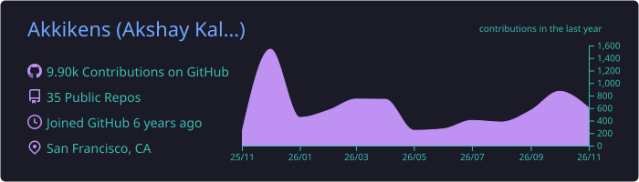
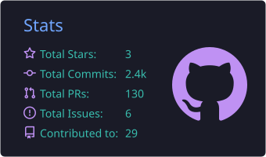
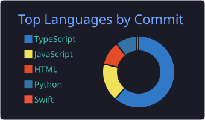

 

  

 

## Now

<table>
<tr>
<td width="50%" valign="top">

### Goldi · [Climb Together](https://www.climbtogether.co)

An AI career agent, taken from prototype to **100K+ users** through a Walmart partnership. Real-time voice, event-driven integrations, and an eval harness that gates every release.

   

</td>
<td width="50%" valign="top">

### Agent platform · [Softmax](https://softmax.com)

An MCP tool harness and Claude Code plugin system: **86 skills** that 20 engineers used every day, with scoped tools, human review and tracing on every agent job.

   

</td>
</tr>
</table>

## Things I've built

<table>
<tr>
<td width="33%" valign="top">

**[agent-harness-lab](https://github.com/Akkikens/agent-harness-lab)** 
Sandboxed tools, crash-safe runs, replay evals. 

</td>
<td width="33%" valign="top">

**[mcp-policy-gateway](https://github.com/Akkikens/mcp-policy-gateway)** 
Identity-aware MCP gateway with signed policies. 

</td>
<td width="33%" valign="top">

**[secure-agent-service](https://github.com/Akkikens/secure-agent-service)** 
Agent with approval gates and audited RAG. 

</td>
</tr>
<tr>
<td width="33%" valign="top">

**[shopify-commerce-lab](https://github.com/Akkikens/shopify-commerce-lab)** 
Shopify app, Hydrogen storefront, AWS webhooks. 

</td>
<td width="33%" valign="top">

**[dbt-orchestrator-lab](https://github.com/Akkikens/dbt-orchestrator-lab)** 
Job scheduler with leases, fencing and Kafka. 

</td>
<td width="33%" valign="top">

**[prtray](https://github.com/Akkikens/prtray)** 
GitHub pull requests in your Mac menu bar. 

</td>
</tr>
</table>

## Stack

  

## Activity

  
   
  
  
  

